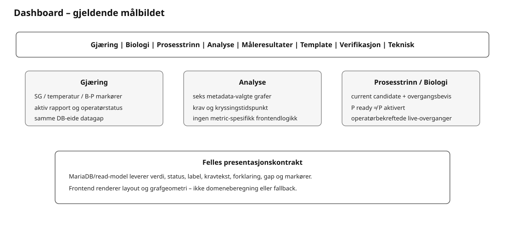
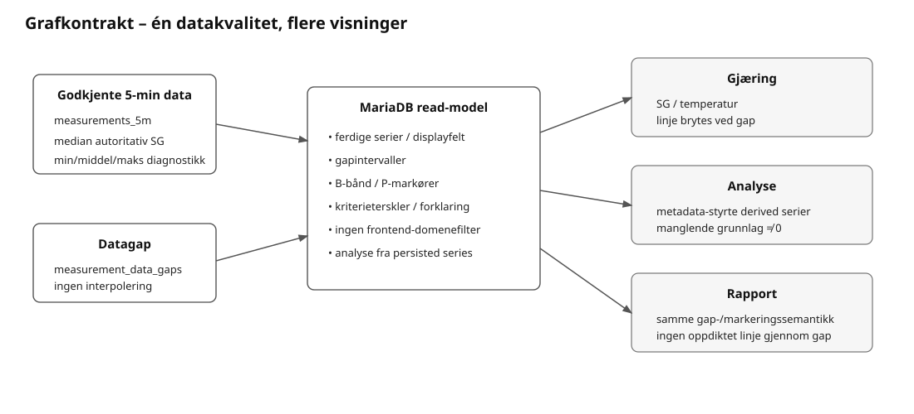

# 03 – Krav: Home Assistant-dashboard

**Rolle:** Normative krav til operatørflaten. Frontend er ren visning/interaction; domeneberegning, fallback og kriterietolkning hører ikke hjemme her.

## Målstruktur

Dashboardet har åtte hovedfaner:

1. **Gjæring** – én relevant livsløpsflate: før Start, aktiv session eller avsluttet session. Aktiv visning prioriterer status, hovedgrafer, rapport og neste operatørhandling.
2. **Biologi** – B1–B6, aktiv fase/kandidat, fasevarigheter, klassifikasjonsgrunnlag og kriterietabell.
3. **Prosesstrinn** – P1–P15, status, inngangsvilkår, kriterievurdering, mål, faktisk start/varighet og manuell overgang.
4. **Analyse** – metadata-deklarerte avledede tidsserier. Grafen viser analyseverdien selv; forklaring, enhet, serie, B/P-markører, terskler og gap-policy kommer fra DB-read-model.
5. **Måleresultater** – komplett atomisk målesett, sensorisk betydning og målehistorikk.
6. **Template** – grafisk editor mot normalisert template i MariaDB via Node-RED; ingen JSON-tre-editor som ordinær brukerflate.
7. **Verifikasjon** – strukturert REQ→VER→TEST/resultat, TECH/FUNC/UAT-status, UAT-registrering og verifikasjonseksport.
8. **Teknisk** – Systemkontroll, runtime/datagrunnlag, målekilde, aktive problemer, teknisk hendelsesstrøm og kompakt verifikasjonsstatus.

## Grafisk kontrakt

- Gjæring-grafen åpner på hele aktive forløpet fra pitch til nå.
- SG, temperatur og trykk vises vertikalt stablet med synkronisert tidsakse.
- SG-hovedkurven bruker autoritativ 5-minutters SG fra godkjente prøver; min/maks-båndet skal være tydelig nok til at spredningen i samme godkjente bøtte kan leses direkte. Tilsvarende min/maks-bånd brukes i øvrige grafer der kildeserien har et reelt spenn.
- Registrerte `measurement_data_gaps` bryter kurven; frontend skal ikke interpolere eller tegne linje gjennom gap.
- Manuell SG markeres som diamant ved korrigert verdi og kan forbindes med nærmeste tidsrelevante Tilt-verdi.
- P-start markeres gjennom grafstakken; biologiske B-faser ligger som tydelige bakgrunnsfelt.
- Sensorikk, kommentarer, anbefalinger og handlinger uten naturlig Y-verdi ligger i eget hendelsesspor.
- Alle grafer skal få DB-eid dynamisk Y-akse fra faktisk min/maks og relevante mål/kriteriegrenser, med liten tegnemargin og uten kunstig spenn som flater ut detaljene.
- Rapportgrafene skal bruke samme grafkontrakt, min/maks-bånd, aksemetadata og gapgrunnlag som dashboardet, ikke en separat domenetolkning.

## Gjeldende krav

| ID | Status | Krav |
|---|---|---|
| REQ-HA-001 | Fastsatt | Løsningen bruker flow-opprettede HA-entiteter og eget Lovelace-kort; ingen HA-package kreves. |
| REQ-HA-002 | Fastsatt | Biologisk fase, biologisk kandidat, aktivt prosesstrinn og anbefalt prosesstrinn skal være tydelig adskilt. |
| REQ-HA-003 | Fastsatt | Hovedgrafen åpner med hele aktive forløpet fra pitch til nå. |
| REQ-HA-004 | Fastsatt | SG vises som den autoritative validerte 5-minuttersserien med tydelig min–maks-bånd fra samme godkjente prøvesett. Båndet skal synliggjøre målespredning, ikke skjules av unødvendig stor Y-akse. |
| REQ-HA-005 | Prototype | SG, temperatur og trykk vises som tre vertikalt stablede, synkroniserte grafer med samme tidsutstrekning. |
| REQ-HA-006 | Fastsatt | Datagap skal være visuelt synlige og kurver skal brytes. |
| REQ-HA-007 | Fastsatt | Historiske forløp skal ha egen sammenligningsvisning. |
| REQ-HA-008 | Fastsatt | Historisk tidsanker skal kunne velges mellom pitch og registrert aktivitet. |
| REQ-HA-009 | Fastsatt | Dashboardet viser alarm/status, men v1 sender ikke direkte varsler. |
| REQ-HA-010 | Fastsatt | Skjemadata registreres i flow-opprettede HA-entiteter og lagres samlet med én knapp. |
| REQ-HA-011 | Fastsatt | Node-RED-motoren validerer operatørgrunnlaget mot MariaDB og persisterer atomiske domeneoperasjoner i MariaDB. HA/dashboard er operatør-/presentasjonslag og skal ikke være alternativ domenemotor eller sannhetskilde. |
| REQ-HA-012 | Prototype | Custom-kortet skal hente en eksplisitt read-model som er avledet fra kvitterte MariaDB-data via Node-RED. Transportformatet kan utvikles videre, men frontendprojeksjonen er aldri persistent autoritet. |
| REQ-HA-013 | Fastsatt | Historisk sammenligning skal lese eksplisitt valgt eksport read-only, justere tidsforløp etter lagrede ankere og aldri aktivere eller endre den historiske sesjonen. |
| REQ-HA-014 | Fastsatt | Node-RED-status eksponeres som direkte HA-entiteter via WebSocket-integrasjonen, ikke via MQTT Discovery. |
| REQ-HA-015 | Fastsatt | Gjæringsmotoren skal ikke bruke MQTT Discovery for sine HA-statusentiteter. Sensoringest kan bruke relevant transport, mens operatør-/statusentiteter opprettes av Node-RED gjennom HA WebSocket-integrasjonen. |
| REQ-HA-016 | Prototype | Statuslaget omfatter system/sesjon, biologisk fase/kandidat/sikkerhet, aktiv/anbefalt prosess, tilsynelatende utgjæringsgrad, SG-hastighet, datakvalitet, målingsalder, anbefaling og alarm. |
| REQ-HA-017 | Fastsatt | Biologiske faser og prosesstrinn vises i separate visninger; førstesiden viser bare en kompakt biologisk tidslinje. |
| REQ-HA-018 | Fastsatt | Tidskorrigering for biologiske faser bruker valgt registrering og dato/tid, uten begrunnelseskrav. Originalt, manuelt og effektivt tidspunkt skal kunne vises og overstyringen kunne fjernes. |
| REQ-HA-019 | Fastsatt | Dashboardets målstruktur har åtte faner: `Gjæring`, `Biologi`, `Prosesstrinn`, `Analyse`, `Måleresultater`, `Template`, `Verifikasjon` og `Teknisk`. |
| REQ-HA-020 | Prototype | Biologivisningen viser total tid til stabil utgjæring, tid i aktiv fase, forventet intervall og faktisk varighet per fase. |
| REQ-HA-021 | Prototype | `Gjæring` skal prioritere oversikt og normalt kreve lite eller ingen vertikal scrolling på bred skjerm. |
| REQ-HA-022 | Fastsatt | Dashboardet skal ikke referere til entiteter som ikke opprettes av flowen. |
| REQ-HA-023 | Prototype | Gjæring- og prosessvisningen viser biologisk utløser, beredskap og estimert mulig start for neste prosesstrinn. |
| REQ-HA-024 | Fastsatt | Manuelle observasjoner registreres som komplette målesett; første sett inngår i Start. Prosess-readiness og kaldkrasjvurdering vises under `Prosesstrinn`. |
| REQ-HA-025 | Prototype | `Start demo` er en flow-opprettet HA-knapp, og demo lastes ikke automatisk. |
| REQ-HA-026 | Fastsatt | Før sessionstart skal dashboardet støtte templatevalg, startdata, første komplette målesett og historisk rapport uten å vise misvisende aktive-session-kontroller. |
| REQ-HA-027 | Fastsatt | Måleresultater bruker tre kolonner på bred skjerm; målehistorikk bruker full bredde. |
| REQ-HA-028 | Prototype | Prosesstrinn viser planlagt anker/mål mot faktisk start og varighet. |
| REQ-HA-029 | Fastsatt | I `sections`-visninger skal bredde settes på det ytre `conditional`-kortet; kort i Gjæring, Biologi og Prosesstrinn skal ha `grid_options.columns: full` og stables vertikalt. |
| REQ-HA-030 | Fastsatt | `Gjæring` skal vise én relevant livsløpsflate om gangen: templatevalg, konfigurert start, aktiv sesjon eller avsluttet sesjon. |
| REQ-HA-031 | Fastsatt | `Måleresultater` skal vise tekstlig betydning for valgt 0–5-nivå for hver sensoriske parameter. |
| REQ-HA-032 | Fastsatt | Prosessport og kaldkrasjvurdering skal ligge under `Prosesstrinn`, ikke under målingsskjemaet. |
| REQ-HA-033 | Fastsatt | Trykk, kjølemaskinens settpunkt og kjølemaskinens kalibreringsverdi skal kunne registreres i observasjonsfanen. |
| REQ-HA-034 | Fastsatt | Teknisk-fanen skal vise systemkontroll, runtime, datakvalitet, siste måling, målingsalder og oppmerksomhetsstatus. |
| REQ-HA-035 | Fastsatt | Dashboardet skal bruke korte visningsnavn; prefikset «Gjæringsassistent» skal ikke gjentas i hver rad. |
| REQ-HA-036 | Fastsatt målkrav | Templatefanen skal være grafisk og administrere/redigere normaliserte template-data gjennom Node-RED-motorens MariaDB-operasjoner, ikke et JSON-tre. Registry skal styre tilgjengelige metrics/modeller/parametere, og valideringsfeil skal vises konkret ved relevant felt og samlet før publisering. |
| REQ-HA-037 | Fastsatt | Skjulte livsløpskort skal ikke etterlate misvisende tomme kontrollflater; brukeren skal se hvorfor en handling ikke er tilgjengelig. |
| REQ-HA-038 | Fastsatt | Graf-/hendelsesmarkører skal vise faktiske observasjoner, anbefalinger og utførte prosesshandlinger med tidspunkt. Frozen plan endres ikke underveis. |
| REQ-HA-039 | Prototype | Dashboardet prioriteres for stor skjerm. Måle- og prosesskort kan være brede selv om mobilvisningen blir lengre. |
| REQ-HA-040 | Fastsatt | Manuell SG vises som diamant ved korrigert verdi, med tynn linje til Tilt-verdien på samme observasjonsrunde. |
| REQ-HA-041 | Fastsatt | Manuell temperatur vises ved målt temperatur, kjølesettpunkt som firkant på stiplet observasjonskurve og trykk som punkt ved målt bar. |
| REQ-HA-042 | Fastsatt | Sensorikk og kommentarer uten naturlig Y-verdi vises i et smalt hendelsesspor under grafene. |
| REQ-HA-043 | Fastsatt | Prosesstart vises med mørk stiplet linje gjennom alle tre grafer og P-flagg i to høyder når markørene ligger tett. Tooltip viser trinn, tidspunkt, inngangsvilkår og advarsler. |
| REQ-HA-044 | Fastsatt | Biologiske faser vises som tydelige, vekslende bakgrunnsfelt gjennom grafstakken med fasegrense og B1–B6 i SG-grafen. |
| REQ-HA-045 | Fastsatt | Biologitabellen viser regel, parameter, aktuell verdi, terskel, vedvarende tid, datakvalitet, status, venteforklaring, kilde, regeltype og usikkerhet. |
| REQ-HA-046 | Fastsatt | Prosesstrinnkortet leser kontrollport, vilkår, vurdering og tillatte handlinger fra en MariaDB-avledet read-model publisert via Node-RED og skal ikke være avhengig av hardkodede status-entity-ID-er for å kunne tegnes. |
| REQ-HA-047 | Fastsatt | `Måleresultater` skal ha en tydelig `Lagre målinger`-handling som lagrer ett komplett atomisk målesett; ved valideringsfeil beholdes alle inndata. |
| REQ-HA-048 | Fastsatt | Prosesstrinnoversikten skal minst ha kolonnene `P`, `Status` og `Prosesstrinn`, og dessuten vise inngangsvilkår, vurdering, målverdier for temperatur/trykk, faktisk start og faktisk varighet uten at disse blandes sammen. |
| REQ-HA-049 | Fastsatt | Kortet for utløser/kontrollport/manuell overgang skal vise hva som utløser vurderingen, hvilke kriterier som er oppfylt/venter/advarer, og hvilke manuelle handlinger som er tillatt. |
| REQ-HA-050 | Fastsatt | `Vurdering av neste prosesstrinn` skal vise anbefalt neste trinn og anbefalte temperatur-/trykkmål med begrunnelse og datagrunnlag. |
| REQ-HA-051 | Fastsatt | `Teknisk` skal ha en samlet strøm/logg for tekniske feil og avvik fra ulike deler av systemet, med tidspunkt, kilde, alvorlighet, melding og relevant kontekst. Denne fungerer som en lesbar teknisk hendelses-/debugflate og er separat fra aktiv oppmerksomhetsstatus. |
| REQ-HA-052 | Fastsatt | Før Start skal `Gjæring` samle templatevalg, startgrunnlag og første målesett i samme livsløpsflate. Første målesett skal ligge nederst i Start-flaten, og alternative tetthetsskalaer skal ikke introduseres; hele brukerflaten er SG-basert. |
| REQ-HA-053 | Fastsatt | Ved aktiv session skal `Gjæring` tilby eksplisitt **Avslutt gjæring**. Etter kvittert avslutning skal en egen `completed`-flate vises og nye gjæringsmålinger være utilgjengelige. |
| REQ-HA-054 | Fastsatt | Completed-flaten skal tilby **Gjør klar for ny gjæring**. Reell session skal vise/svare på eksportgaten; demo kan frigjøres uten eksport. |
| REQ-HA-055 | Fastsatt | Kriterietabellene i Biologi og Prosesstrinn skal vise **Datavindu** som kompakt beskrivelse av faktisk vurderingsgrunnlag. `window_median_range` viser vinduslengde og antall datapunkter; `stability_window` viser vinduslengde, faktisk tidsdekning og antall datapunkter. Rå timestamp skal ikke brukes som erstatning for datavindu. |
| REQ-HA-056 | Fastsatt | En akseptert operatørkommando skal ha enkel global gjentakelsesbeskyttelse i 8 sekunder slik at nytt klikk ikke sendes mens GUI/read-model normalt rekker å oppdatere. Beskyttelsen er flyktig UI/runtime-tilstand og erstatter ikke `operation_id`/DB-constraints. |
| REQ-HA-057 | Fastsatt | Kriteriestatus skal skille faktisk `Konfigurasjonsfeil` fra `Mangler grunnlag`, `For lite grunnlag`, `Foreldet`, `Ikke oppfylt`, `Oppfylt` og `Ikke vurdert`. Frontend skal bruke persistert evaluatorstatus, ikke utlede alle `valid=0` som konfigurasjonsfeil. |
| REQ-HA-058 | Fastsatt | Aktiv kriteriekorreksjon og registrert kriteriefravik skal være tydelig visuelt markert direkte ved kriteriet. Markeringen skal ikke erstatte eller farge om selve oppfylt/ikke-oppfylt-statusen. |
| REQ-HA-059 | Fastsatt | Målehistorikken skal vise persistente SG-, temperatur-, prosess- og sensorikkfakta eksplisitt, inkludert nærmeste Tilt-SG og ΔSG for manuell korrigert SG når et tidsmessig relevant Tilt-punkt finnes. Horisontal scrolling er tillatt fremfor sammenslåtte kryptiske kolonner. |
| REQ-HA-060 | Fastsatt | Fanen **Analyse** skal ligge mellom Prosesstrinn og Måleresultater og tegne de analysene den aktive sessionens metadata deklarerer. Grafene viser den avledede verdien selv; label, forklaring, enhet, serie, B/P-markører, kriterieterskler og gap-policy leveres fra DB-read-model. Under hver graf skal de B-/P-trinnene som bruker analysen vises med kriterium, rolle, krav og tidspunkt kravet først ble oppfylt. Samme requirements-read-model skal drive både terskellinjer/oppfyllelsesmarkører og tabellen. Frontend skal ikke kjenne W-34/70s graf-ID-er eller beregne analysen. |
| REQ-HA-061 | Fastsatt | Template-fanen skal ha et komplett templatebibliotek med lifecycle `draft/published/retired`, statusfilter, åpning av eksisterende versjoner, ny draft/ny template, publisering, forkasting, retire og reaktivering. Template-administrasjonens valgte versjon skal være MariaDB-persistet og uavhengig av Start-valget og aktiv session. Publisering skal ikke implisitt endre Start-valget. |

## Layoutdetaljer

### Gjæring – før Start

- Template velges i Start-flaten.
- Startdata, pitchdata og første komplette målesett grupperes tydelig; SG er eneste tetthetsskala.
- Historisk rapport kan velges/genereres uten at kontroller for aktiv session vises.
- På bred skjerm skal flaten utnytte bredden og unngå unødvendig vertikal scrolling.

### Aktiv Gjæring og rapport

- **Aktiv gjæring** samler status og gjæringsforløp øverst. Rapportlenke, rapportdato og den kompakte genereringsknappen ligger nederst. Pitchtid korrigeres separat under Måleresultater; observasjonstid er en annen korreksjon.
- `Generer rapport` er en ordinær liten operatørknapp, omtrent en halv kolonne på bred skjerm.
- Rapporten viser DB/read-model-innhold. Frontend/renderer beregner ikke domeneverdier.
- Hovedgrafene oppdateres når ny committed 5-minuttersmåling er tilgjengelig.

### Prosesstrinn

Oversikten viser minst `P`, `Status`, `Prosesstrinn`, `Inngangsvilkår`, `Vurdering`, `Mål temp/trykk`, `Faktisk start` og `Varighet`.

Raden **Overgang** med `Tilbake`/`Neste` ligger rett over kriterietabellen **Vurdering av neste prosesstrinn**. Kriteriekorreksjon vises når frozen template tillater korrigerbare parametere; kriteriefravik vises bare når frozen policy tillater det og kriteriet ikke allerede er oppfylt. Aktiv korreksjon/fravik markeres ved kriteriet uten å omskrive oppfylt/ikke-oppfylt-status.

Kolonnen **Datavindu** viser ferdig `data_window_display` fra MariaDB-read-model og skal ikke rekonstrueres i frontend.

### Analyse

Analyse-fanen er generisk. Frontend itererer graph/series/read-model-rader og skal ikke branche på W-34/70s graph-ID-er eller metric-ID-er. Kurver tegnes bare for persisterte gyldige analysepunkter; manglende minste beregningsgrunnlag skal fremstå som fravær/gap, aldri syntetisk null; punkter publiseres først når frozen minstegrunnlag er oppfylt. Under hver graf vises den DB-eide requirements-listen for analysen; dette er samme datagrunnlag som brukes til kriterieterskler og markering av første `met_at`, slik at graf og tabell ikke kan få parallelle kriteriesannheter.

### Måleresultater

På bred skjerm brukes tre kolonner for registreringsfeltene og full bredde for historikken. Historikken viser metode, målt/korrigert SG, prøve-/kalibreringstemperatur, nærmeste Tilt-SG og ΔSG, manuell temperatur, trykk, kjølemål/-offset, gjærlåsaktivitet og sensorikk/utfelling som egne lesbare felt.

### Template

Template-fanen viser alltid Templatebiblioteket, også uten Start-valg og under aktiv session. Publiserte og retired versjoner er read-only; draft er redigerbar. `retired` kan aktiveres igjen. En aktiv session vises som informasjonsmarkør med frozen kildeversjon, men blokkerer ikke administrasjon av fremtidige templates. Template-fanens versjonsvalg endrer aldri Start-valget. Lokal inntasting registreres før blur og bevares ved automatiske/asynkrone oppdateringer; ny-template-felter og publiseringsetikett beholdes ved rerender. Ekspanderte UI-rader er lokal presentasjonsstate og skal ikke kollapses av irrelevant refresh.

### Teknisk

Teknisk-fanen viser mer enn samlet PASS/FAIL: runtime/datagrunnlag, målekilde/Tilt, aktive problemer, inntil 50 persistente tekniske hendelser og detaljert Systemkontroll. Tekniske feil som fanges av den generelle catch-banen skal være synlige her selv om de ikke lenger er aktiv alarm.

### Verifikasjon

| ID | Status | Krav |
|---|---|---|
| REQ-HA-062 | Fastsatt | Dashboardet skal ha egen `Verifikasjon`-fane som viser DB-eid status for krav → verifikasjonskrav → test/resultat og kan filtrere TECH/FUNC/UAT. |
| REQ-HA-063 | Fastsatt | Teknisk-fanen skal vise et kompakt verifikasjonssammendrag med siste DB-eide status og lenke/henvisning til detaljfanen. |
| REQ-HA-064 | Fastsatt | UAT skal kunne registreres fra Verifikasjon-fanen med `pass/fail/blocked/not_run`, operatørnavn, notat og eventuell evidensreferanse. Registreringen skal gi ny DB-kvittert append-only resultatrad. |
| REQ-HA-065 | Fastsatt | Verifikasjon-fanen skal kunne bestille eksport av strukturert JSON og lesbar HTML-rapport. Frontend skal bare bestille og vise DB/read-model-resultatet, ikke beregne rapportinnhold. |
| REQ-HA-066 | Fastsatt | Startflaten skal vise templateens forventede utgjæringsområde og FG-området som er beregnet fra faktisk OG som read-only informasjon. Operatøren skal ikke måtte beregne eller skrive inn forventet FG. |
| REQ-HA-067 | Fastsatt | Analyse-grafer skal bruke DB-eide aksemetadata for vertikal minimum/maksimum/tick-intervall og DB-eid `+dag · dato`-merking horisontalt. Grafbeskrivelsen skal forklare hva verdien måler, hvordan den tolkes og hvorfor den er relevant. |
| REQ-HA-068 | Fastsatt | Alle tidsseriegrafer i Gjæring og Analyse skal bruke MariaDB/read-model-eid dynamisk Y-akse beregnet fra faktisk min/maks samt relevante mål-/kriteriegrenser. Aksen skal ha liten normal tegnemargin og skal ikke få kunstig minimumsspenn for å skjule variasjon. |
| REQ-HA-069 | Fastsatt | Analyse viser ingen estimerte min–maks-/følsomhetsbånd. Målt variasjon kan vises som faktisk spredning i Gjæringsfanens rådatagrafer. Graphpolicy fryses i MariaDB. |
| REQ-HA-070 | Fastsatt | Analysegrafer viser kun ordinære verdier fra godkjente målinger. Manglende grunnlag er synlig; ingen foreløpig kurve, utfylling eller interpolasjon over datagap. |
| REQ-HA-071 | Fastsatt | SG-rate vises med DB-eid nedre Y-grense 0 og automatisk øvre grense. Negative målebaserte rater beholdes i databasen og i siste-verdi-feltet; de erstattes ikke med absoluttverdi eller null. |
| REQ-HA-072 | Fastsatt | Kriteriekorreksjon og kriteriefravik skal følge p22-arbeidsformen. Notat er valgfritt og tomt notat skal ikke avvise handlingen; korreksjon/fravik skal vises separat fra kriteriets faktiske `met/not_met`-status. |
| REQ-HA-073 | Fastsatt | Teknisk-fanen skal tilby separat **Eksporter måledata** for aktiv session. Eksporten bygges fra MariaDB og omfatter sessiongrunnlag, 5-minuttersmålinger med min/middel/median/maks der tilgjengelig samt registrerte datagap. |

## Funksjonelle referanser

Der graf/layoutregresjon sammenlignes visuelt, kan `p17r12` brukes som uttrykkelig funksjonell referanse. `p18-r5` er funksjonell/designmessig referanse for blant annet rapportdekning. Ingen av dem er teknisk runtime-baseline; gjeldende MariaDB/Node-RED-arkitektur gjelder alltid.

## Analyse

Analyse viser som standard tre forklarbare fenomener: tilsynelatende utgjæringsgrad, signert SG-rate og SG-stabilitet. Vertikal minimum, maksimum og tick-intervall beregnes av MariaDB/read-model fra den aktuelle sessionens serier og relevante kriteriegrenser. Horisontal dag/dato-merking kommer fra MariaDB-read-model. Frontend skal ikke finne egne domenebetingede aksegrenser eller nye prosentbegreper.

Pitchtemperatur er ikke et separat startfelt; første manuelt målte temperatur er temperaturgrunnlaget ved pitch. Pre-start-kladd skal ikke republiseres periodisk til redigerbare HA-felt mens operatøren skriver; restore retries ved faktisk MariaDB-utilgjengelighet i stedet for periodisk overskriving.

| ID | Status | Krav |
|---|---|---|
| REQ-HA-074 | Fastsatt | Manuelle utgjæringskontroller vises som separate punkter i samme graf som rå Tilt-serien, med faktisk måletid. Punktserie bindes ikke sammen til en oppdiktet kontinuerlig manuell kurve. |
| REQ-HA-075 | Fastsatt | Dashboard, aktiv rapport og sluttrapport bruker samme DB-eide horisontale tidsakse fra effektivt pitchtidspunkt. Før første beregnbare verdi vises en tom graf med akse. Datagap bryter linjer og bånd. |

SG-rate bruker målte endepunkter i et sammenhengende 24-timersvindu med minst 18 timers faktisk tid. Grunnlag og siste-verdi-tekst kommer fra MariaDB; ingen regresjon eller følsomhetsbånd.

| Krav-ID | Status | Krav |
|---|---|---|
| REQ-HA-076 | Fastsatt | Aktiv gjæring skal samle batch/gjær, volum/OG, effektiv pitch og varigheter, B/P-status, rå Tilt-SG, én aktuell utgjæringsgrad, estimert ABV nå, fersk 24-timersrate, 24/48-timersstabilitet og neste prosesstrinn med årsak/vurderingstid. Verdier og basis leveres av read-model; rapporthandlinger ligger nederst. |
| REQ-HA-077 | Fastsatt | SG-stabilitet har generelle 24-/48-timerskurver på faktiske sammenhengende målinger. Verdien er maks–min i SG-poeng, uten bånd, kortvindu-oppskalering eller faseanker. Minste tidsdekning og dynamiske akser eies av DB. |

| REQ-HA-078 | Fastsatt | Over hver analysegraf vises MariaDB-forberedt siste gyldige verdi, enhet og faktisk måletid for hver serie. Manglende grunnlag vises uttrykkelig; siste måling fremstilles ikke som en ny måling nå. |
| REQ-HA-079 | Fastsatt | Avsluttet gjæring skal vise DB-eid arkivstatus og støtte nytt arkiveringsforsøk uten ny avslutning. Uverifisert sluttarkiv skal fortsatt blokkere Gjør klar for reell gjæring og inngå vedvarende i Systemkontroll. |

## Historikk og grafer i gjeldende release

| ID | Status | Krav |
|---|---|---|
| REQ-HA-080 | Fastsatt | Grafene kan sammenligne med et referansedatasett eller en avsluttet gjæring, justert til tid siden pitch og med egne analyseverdier. |
| REQ-HA-081 | Fastsatt | Grafvisningen kan velge 5/15/60-minutters detaljvisning og hele gjæringen/siste 24 timer/48 timer/7 dager uten å endre lagrede målinger. |
| REQ-HA-082 | Fastsatt | Avsluttet gjæring forblir synlig under arkivering; nytt forsøk vises når arkiv mangler/feiler, og Gjør klar følger DB-verifisert eksport. |

## P24r8 visning og diagnostikk

| ID | Status | Krav |
|---|---|---|
| REQ-HA-083 | Aktiv | Gjæringskortet skal vise DB-eid målekildetekst direkte, og synliggjøre feil ved lasting/tegning. |
| REQ-HA-084 | Aktiv | Graf- og demovalg skal nå DB med operation_id. Grafvalg skal bekreftes med akkurat sendt operation_id; periodisk refresh skal ikke tegne om et ventende valg. |
| REQ-HA-085 | Aktiv | Analyse skal også vise SG, temperatur og trykk med delt sammenligning. Analyse- og rapportgrafer skal være om lag 40 prosent høyere. |
| REQ-HA-086 | Aktiv | Teknisk eksport skal tilby kompakt standarddiagnostikk og eksplisitt utvidet diagnostikk med faktisk publisert dashboardgrunnlag; grafvalg og detalj/timeimportens omfang skal følge eksporten. |

## P24r9 grafvalg og gjeldende krav

| ID | Status | Krav |
|---|---|---|
| REQ-HA-087 | Aktiv | Graf- og demovalg skal akseptere direkte kommando, payload.data, payload.event og payload.event.data. Det sendte operation_id skal bevares helt til DB-bekreftelse. |
| REQ-HA-088 | Aktiv | Kravlinjer, kravtekst og oppfylt-markeringer i dashboard/rapport skal følge gjeldende kriterierevisjon. Reset bruker originalparametere, eksplisitt tom grense forblir tom, og korrigert stabilitetsvindu knyttes til rett måleserie. |

## P24r10 arkivutveksling

| ID | Status | Krav |
| --- | --- | --- |
| REQ-HA-089 | implemented | Template og arkiv tilbyr filvalg, forhåndsvisning, import, eksport og separate system-, egen- og importert-kategorier. Historikk kan skjules fra sammenligning uten sletting. |

## P24r11 arkivvalg

| ID | Status | Krav |
| --- | --- | --- |
| REQ-HA-090 | implemented | Arkivkortet ligger øverst i Templatefanen og tilbyr aktiv eksport og bekreftet permanent sletting av historiske sesjoner og ubrukte importerte templates. |
| REQ-HA-091 | implemented | Ett samlet filvalg leses av backend til en liste etter template-navn. Deretter velges bare template eller template med gjæringsdata. Valg beholdes ved oppdatering; SHA-advarsler vises før import. |

## Historisk import (p24r15)

| Krav | Status | Kravtekst |
| --- | --- | --- |
| REQ-HA-092 | Aktiv | Det vanlige startbildet skal tilby «Importer avsluttet gjæring» med sluttidspunkt. Angitt «Start fra», template og første måleserie gjenbrukes. B/P har etterregistrering av manglende faktisk fasestart; alle viste varigheter kommer fra DB. |

Velg historisk start i «Start fra» og lagre tidspunktet før import. Fyll de vanlige startmålingene, velg sluttdato/tid og trykk «Importer avsluttet gjæring». Tidsfeltene bruker Europe/Oslo. Etter import vises målekilden HISTORISK. Etterregistrerte målinger lagres først ved sluttgrensen; bruk eksisterende «Korriger tidspunkt for målerunde» for faktisk historisk måletid. Eksisterende P/B-visits korrigeres som før; manglende fase/trinn kan etterregistreres i tidskortet uten å konstruere et automatisk vurderingsbevis.

