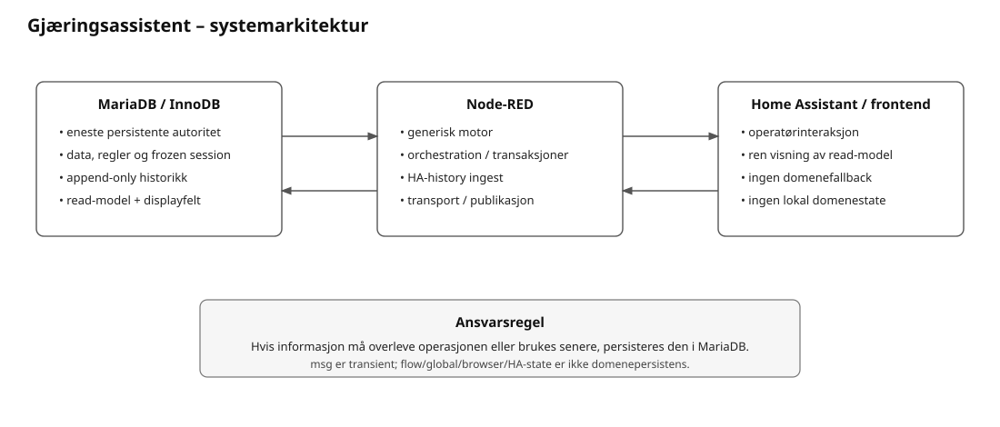
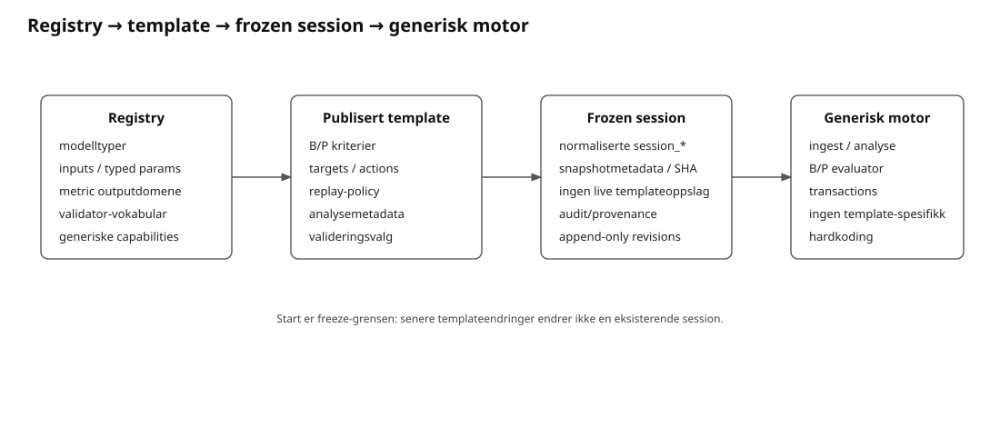
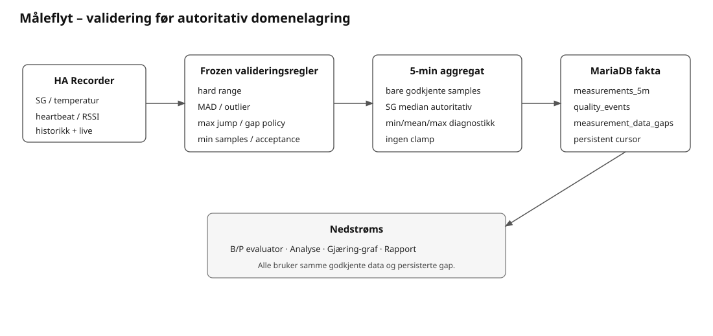
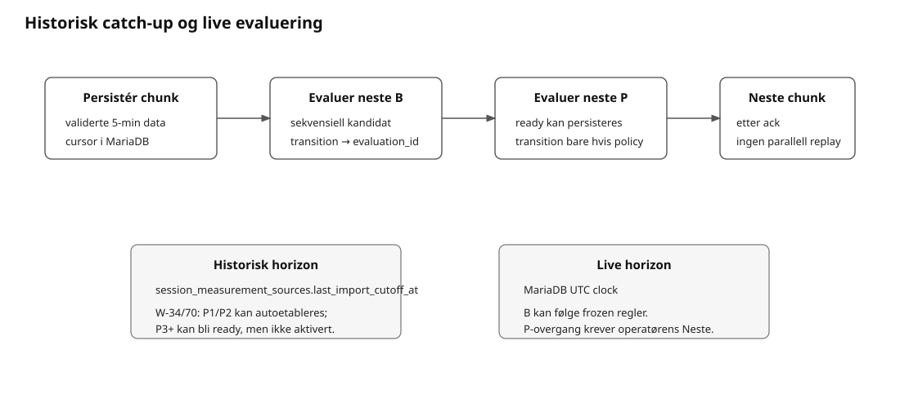

# 07 – Systemarkitektur og dataflyt

**Rolle:** Hovedinngang til gjeldende arkitektur, ansvar og dataflyt.



## 1. Ansvarsdeling

```text
MariaDB = data, regler, read-model og ferdig presentasjonsinnhold
Node-RED = generisk motor, orchestrering, integrasjon og transport
Home Assistant/frontend = operatørinteraksjon og visning
```

- MariaDB/InnoDB er eneste persistente authority.
- Det finnes ingen separat applikasjonsbackend mellom Node-RED og MariaDB.
- `flow.*`, skrivbar `global.*`, browser-state, HA-state og runtimefiler skal ikke være nødvendig domenepersistens.
- Node-RED kan implementere generiske algoritmer/modelltyper, men fagregelvalg/terskler/vinduer/policy ligger i registry/template/frozen session.
- Frontend viser ferdige DB/read-model-felt og utfører bare UI-/renderingmekanikk.
- Rene reads kan kjøres parallelt. Faglige mutasjoner er korte atomiske transaksjoner. InnoDB håndterer concurrency; ingen global writer-kø eller normal eksplisitt locking.
- Runtimehistorikk er append-only når ny tilstand kan uttrykkes som nye fakta/revisions. Current-state utledes i views.

## 2. Registry → template → frozen session → motor



```text
MariaDB registry
  ↓ tillatte generiske modeller, inputs og typed parametere
Publisert template
  ↓ konkret regelvalg, B/P, targets, validering og analysemetadata
Start
  ↓ atomisk freeze
Normalisert session-plan
  ↓
Node-RED generisk evaluator/ingest/analyse
  ↓
Persistente facts, evaluations, transitions og analysis_series
  ↓
MariaDB read-models
  ↓
HA/frontend
```

Ugyldig eller manglende frozen regelgrunnlag er konfigurasjons-/datagrunnlagsfeil. Motoren skal ikke reparere dette med skjulte defaults.

## 3. Måleflyt og datakvalitet



```text
HA Recorder-history / live history
   ↓
source/session-frozen validation rules
   ↓ forkast ugyldige prøver; ingen clamp
robust 5-min aggregat
   ↓
measurements_5m + measurement_ingest_quality_events
   ↘ measurement_data_gaps
   ↓
B/P evaluator + Analyse
```

Heartbeat avgjør kildekontinuitet. Datagap persisteres eksplisitt og bryter persistens, grafer og andre regler som krever sammenhengende datadekning. `session_measurement_sources.last_import_cutoff_at` er persistent importcursor; omstart leser cursor fra MariaDB og henter manglende periode fra HA Recorder.

Uten aktiv reell session startes ingen periodisk HA-history-import.

## 4. Historisk replay og live



Historisk catch-up sekvenseres:

```text
persistér 5-min chunk
→ evaluer neste B-kandidat
→ evaluer neste P-kandidat
→ persister result/evidence/evt. tillatt transition
→ neste chunk
```

Historisk evalueringshorizon er persistert importcutoff. Live-horizon er MariaDB UTC-klokke.

B-progresjon er sekvensiell. P-kriterier kan vurderes historisk, men overgang persisteres automatisk bare når frozen `historical_replay_auto_transition_allowed` er sann for akkurat neste steg. Ordinære/live P-overganger er operatørbekreftet.

En persistert transition peker på eksakt `evaluation_id`. Historisk overgangsbevis og current candidate-evaluering er derfor separate read-model-fakta.

## 5. Analyse

Om en beregnet verdi skal ha graf, og hvordan den behandles/presenteres, ligger i template/sessionmetadata. Motor og frontend skal ikke ha graph-ID-spesifikke branches.

P24r7 persisterer kun ordinære analysepunkter når frozen minstegrunnlag, gapkrav, inputdomene og outputdomene er gyldige. Gyldige punkter persisteres append-only i `analysis_series_values`; manglende grunnlag skaper ikke syntetiske nullverdier.

## 6. Read-model og frontendgrense

```text
persistente fakta + frozen regler
  ↓
generisk motor persisterer resultat/provenance
  ↓
MariaDB views lager ferdige value/status/display-felt
  ↓
Node-RED transport
  ↓
HA/custom card
```

Frontend kan escape tekst, styre layout, holde ekspandert UI-state og beregne pixelkoordinater for tegning. Frontend skal ikke beregne FG-fremdrift, kriteriestatus, datavindu, alder, targets, gap, anbefaling eller annen domenesemantikk.

## 7. HA- og systemmetadata

HA entity/event-kontrakten ligger i MariaDB-registre og fysisk Node-RED-flow. Bootstrap, HA-avstemming, Systemkontroll og generert kontrakt leser samme metadata. Inputbindinger og select-mappings ligger i DB; manglende mapping er konfigurasjonsfeil, ikke anledning til lokal fallback.

`system_functions`, `information_objects` og `function_information_dependencies` eier maskinlesbar funksjon↔informasjon-lineage. Produsent→objekt→konsument er avledet view, ikke separat sannhet.

## 8. Teknisk observability

Uncaught Gjæringsassistent-feil går gjennom en generell catch/safety-net til `technical_events` når persistensbanen er tilgjengelig. Spesifikke feilbaner kan supplere dette. Systemkontroll og Teknisk-fane leser persistert teknisk grunnlag; de skal ikke opprette en alternativ sensor-/runtimeautoritet.

## 9. Tid og konsistens

Persistent maskintid er UTC. Operative displaytider forberedes i read-model når de er del av domenepresentasjonen. MariaDB-/Node-RED-klokkesammenligning skal ikke avhenge av tvetydig lokal `DATETIME`-parsing.

Konsistens håndheves i denne rekkefølgen: normalisert datamodell → PK/FK/UNIQUE/CHECK → atomisk transaksjon → append-only fakta/revisions → views/read-model → applikasjonsvalidering/presentasjon.
## 10. Verifikasjonsflyt

```text
REQ / DEC / VER / TEST metadata
            +
append-only TECH/FUNC/UAT-resultater
            ↓
MariaDB verification views
            ↓
Node-RED transport/kommando
            ↓
HA Verifikasjon / Teknisk sammendrag
            ↓
JSON + HTML-eksport fra samme DB-grunnlag
```

UAT er en ordinær stateful operasjon: HA-event → validering mot registrert UAT-test → kort DB-transaksjon → append-only run/result → ny read-model. Feil i verifikasjonsmetadata/status rettes i databasen/kilden; frontend eller Node-RED skal ikke fylle inn antatte relasjoner eller status.

## asynkron oppstart og reconnect

MariaDB, Node-RED og Home Assistant må behandles som uavhengige moduler som kan starte, stoppe og koble seg til igjen i vilkårlig rekkefølge. MariaDB er fortsatt eneste persistente domenekilde.

Node-RED kjører en idempotent, read-only restore/reconcile mot MariaDB med periodisk retry. Reconcile republiserer gjeldende DB-state, men oppretter ikke nye biologiske evalueringer eller prosesstransisjoner. Home Assistant-historikkimport har egen retry ved utilgjengelig HA og fortsetter fra den persistente MariaDB-cursoren. Identiske infrastruktursvikt dedupliseres i `technical_events` slik at en frakoblet modul ikke genererer en feilstorm i databasen.

Pitchtemperatur er ikke et separat startfelt; første manuelt målte temperatur er temperaturgrunnlaget ved pitch. Pre-start-kladd skal ikke republiseres periodisk til redigerbare HA-felt mens operatøren skriver; restore retries ved faktisk MariaDB-utilgjengelighet i stedet for periodisk overskriving.

## P24r12: autoritet ved presentasjon og operasjon

MariaDB utleder effektiv beredskap, kriterietellinger, fasevarighet, valgbare handlinger og status-/anbefalingstekst. Den generiske evalueringsmotoren bruker frozen DB-policy og persisterer evalueringen før presentasjon. Node-RED transporterer den ferdige read-modelen, validerer kontrakt og utfører forespurte DB-operasjoner. Ingen egen tabell med HA-valg/defaults eller alternativ beredskapsberegning skal overstyre DB-projeksjonen.

Fysiske HA-koblinger kontrolleres mot `ha_projection_routes`; felt kontrolleres mot `ha_projection_fields`. Avvik skal bli synlige og rettes ved sin autoritative kilde.

## P24r13: én tegner for alle grafer

MariaDB projiserer en felles grafkontrakt gjennom `v_graph_definitions`, `v_graph_series`, `v_graph_axes`, `v_graph_axis_ticks`, `v_graph_time_markers`, `v_graph_latest` og `v_graph_reference_bands`. SQL-adaptere kobler de normaliserte måle-, sammenlignings-, observasjons- og planfakta til metadataenes kildetyper. Den eksisterende metrikkevaluatoren utfører kun DB-valgte beregningsmodeller og lagrer resultatene i MariaDB.

`tools/graph_renderer.js` er eneste SVG-tegner. Byggverktøyet inkluderer identisk kilde i dashboard og begge rapportprodusenter; rapportmodulen bruker samme kildefil. Ingen separat tegner for målegrafer eller rapporter beholdes. Node-RED transporterer DB-kontrakten uten egne standarddata. Eldre arkivkontrakter konverteres ved import før commit, uten å påvirke aktiv gjæring.
